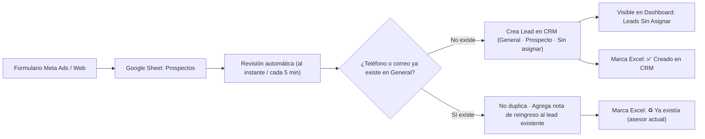

# Manual Operativo: Flujo Automático de Prospectos (Google Sheets → Arias CRM)

> **Propósito:** Eliminar el traspaso manual de prospectos del Excel hacia el CRM, evitar leads duplicados y asegurar atención rápida desde el tablero **Leads Sin Asignar** de la empresa **General**.

---

## 1. Cómo funciona el flujo automático

### Lo que llena automáticamente el sistema en cada lead nuevo
- **Empresa CRM:** `General` · **Estado:** `Prospecto` · **Fuente:** `facebook_ads` · **Asesor:** **Sin asignar**.
- **Contacto y empresa:** Nombre completo, Empresa, Teléfono normalizado (`+503...`) y Correo electrónico.
- **Prioridad automática según urgencia:**
  - `"Lo antes posible"` → **Alta**
  - `"En los próximos 1 a 3 meses"` → **Media**
  - `"Por ahora solo estoy buscando información"` → **Baja**
- **Producto de interés e Industria:** Detecta **ERP** o **SIPLE** según el anuncio/proyectos y mapea la industria al catálogo del CRM.
- **Notas completas del formulario:** Cargo, facturas anuales, gestión actual, punto de mejora, urgencia, anuncio y comentarios quedan guardados en **Notas / Próxima acción** dentro de la ficha del lead.

---

## 2. Responsabilidades por rol (qué SÍ hacer y qué NO hacer)

### A. Equipo Comercial / Ventas (Patricia, Diana, Grecia y futuros asesores)
1. **Dejar de copiar leads manualmente del Excel al CRM.**
2. **Revisar diariamente el bloque `Leads Sin Asignar` en el Dashboard** (o la pestaña **Leads** filtrando `Sin asignar`).
3. **Tomar leads nuevos asignándolos a su nombre**, priorizando siempre los marcados con urgencia **Alta**.
4. **Leer las notas de la ficha antes de llamar/escribir** (ahí ya aparece cargo, rubro, sistema actual, facturas/proyectos y anuncio de conversión).
5. **Si un lead suyo muestra una nota nueva `♻️ Reingreso desde formulario`:** Significa que ese cliente volvió a pedir información en otro anuncio; **no se crea otro lead**, sino que el mismo asesor debe darle seguimiento prioritario.

### B. Equipo de Marketing / Gestión de Formularios
1. **Cada mes nuevo que creen una pestaña** (por ejemplo `DICIEMBRE 2026`, `ENERO 2027`):
   - Copien la **Fila 1 exacta de encabezados** de `NOVIEMBRE 2026` (no importa si agregan o reordenan columnas adicionales, pero **no renombren** `NOMBRE COMPLETO`, `CORREO ELECTRONICO`, `TELÉFONO`, `EMPRESA` ni `ANUNCIO DE CONVERSION`).
   - La columna `ESTADO CRM` se crea o llena sola al final; **nunca borren sus valores ni la cambien de nombre**.
2. **Pestañas de gráficos o reportes:** Deben comenzar con `Análisis`, `Resumen`, `Dashboard`, `Config` o `Plantilla` para que el sistema las ignore y no las procese como leads.
3. **Nunca editar ni borrar manualmente el estado** de filas ya procesadas (`✅ Creado en CRM` / `♻️ Ya existía`). Si una fila fallara por datos vacíos (`⚠️ Fila incompleta`), completar teléfono o correo y borrar únicamente esa celda de `ESTADO CRM` para que el sistema la reintente en la siguiente corrida.

### C. Gerencia / Supervisión
1. **Auditoría en 5 segundos:** Abrir la pestaña del mes en el Google Sheet y revisar la última columna `ESTADO CRM`:
   - `✅ Creado en CRM` → Ya está en el Dashboard listo para que ventas lo tome.
   - `♻️ Ya existía (asesor: Nombre)` → Se evitó un duplicado y se avisó al asesor en las notas del lead.
   - `📌 Histórico previo` → Registros cargados antes de activar la automatización.
   - `⚠️ Fila incompleta` → Entró sin teléfono ni correo válido.
2. **Control de velocidad comercial:** Verificar en el Dashboard cuántos leads permanecen en **Leads Sin Asignar** y en qué prioridad (**Alta** primero).

---

## 3. Mensaje corto listo para enviar por WhatsApp al equipo

> *ACTUALIZACIÓN DE PROCESO: PROSPECTOS AUTOMÁTICOS AL CRM*
>
> A partir de hoy el Excel de prospectos queda conectado directo con **Arias CRM**.
>
> *Qué cambia para el equipo:*
> 1. **Nadie vuelve a copiar leads manualmente** del Excel al CRM.
> 2. Cada registro nuevo del formulario entra automático a **General → Leads Sin Asignar** con su teléfono, correo, empresa, producto (ERP/SIPLE), prioridad y notas completas.
> 3. Si el teléfono o correo **ya existía**, el CRM **no lo duplica**: mantiene al asesor actual y agrega una nota de **Reingreso** en su historial.
> 4. El Excel mostrará al final la columna **`ESTADO CRM`** (`Creado` / `Ya existía`).
>
> *Lo que debe hacer Ventas cada día:*
> • Entrar al Dashboard → **Leads Sin Asignar**, asignarse los leads pendientes (empezando por prioridad **Alta**), leer sus notas y contactar.
>
> *Regla clave al iniciar mes nuevo en el Excel:*
> • Copiar los mismos encabezados de la fila 1 sin cambiar `NOMBRE COMPLETO`, `CORREO ELECTRONICO`, `TELÉFONO`, `EMPRESA` ni borrar la columna `ESTADO CRM`.
