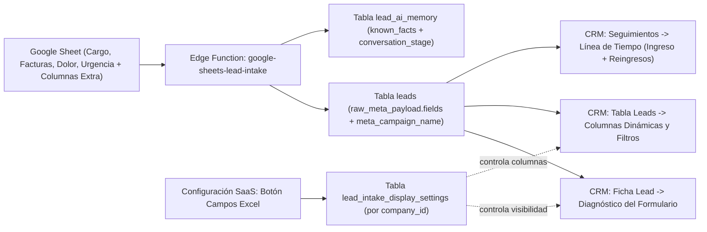

# SOP Operativo — Fase 1: Diagnóstico de Calificación, Historial Completo y Campos Dinámicos (Google Sheets → Arias CRM)

> **Propósito:** Dar visibilidad inmediata al equipo comercial sobre el contexto real de cada prospecto (Cargo, Facturas Anuales, Punto de Mejora / Dolor y Urgencia del Proyecto), eliminar textos cortados en seguimientos, registrar re-ingresos históricos sin duplicados y permitir a cada empresa SaaS configurar qué columnas del Excel se muestran en el CRM.

---

## 1. Alcance y Problema Resuelto

Anteriormente, el ingreso automático desde Google Sheets resumía las columnas del formulario únicamente dentro de notas de texto plano (`next_action_notes`), lo cual ocasionaba que el campo **Next Trigger / Objetivo** truncara la información crítica para calificar al prospecto.

Con **Fase 1**:
1. Toda la carga útil original del formulario queda estructurada en `leads.raw_meta_payload` y alimenta la memoria comercial en `lead_ai_memory`.
2. Cada lead muestra un panel visual de **Diagnóstico del Prospecto** dentro de **Ficha Lead** con semáforo de urgencia.
3. La pestaña **Seguimientos → Línea de Tiempo** reconstruye automáticamente el ingreso inicial y cada re-ingreso posterior sin recortes (`...`).
4. El botón **Campos Excel** permite personalizar por empresa qué columnas aparecen en Ficha Lead, Tabla principal, contexto IA e Historial.

---

## 2. Flujo de Datos Estructurado (Fase 1)

---

## 3. Guía Operativa para el Equipo Comercial

### A. Tarjeta de Diagnóstico en `Ficha Lead`
Al abrir cualquier prospecto en `/leads` (o directamente mediante enlace profundo `/leads?lead=<ID>`):
- **Urgencia del Proyecto:** Muestra insignia de color (*Alta / Inmediata*, *Media*, *Baja*) para decidir velocidad de respuesta.
- **Punto de Mejora (Dolor):** Destaca el área que el prospecto busca resolver (Inventarios, Facturación Electrónica DTE, Contabilidad, Control Integral, SIPLE Lotes, etc.).
- **Facturas Anuales y Cargo:** Permiten dimensionar el tamaño de operación e interlocutor (Gerente, Propietario, Contador) antes de escribir o llamar.
- **Retrocompatibilidad:** Para leads creados antes de Fase 1, `leadIntakeProfile` reconstruye los datos automáticamente desde `next_action_notes`.

### B. Revisión en Tabla Principal (`/leads`)
- En la barra de filtros superior se habilitan filtros por **Punto de Mejora** y **Urgencia Form**.
- Las columnas marcadas en configuración aparecen dinámicamente en la tabla con capacidad de ordenamiento (`intake:<key>`).

### C. Historial Sin Truncamientos en `Seguimientos`
- La sección **Next Trigger** muestra un objetivo breve y limpio.
- Todo el detalle del primer contacto por formulario y cada re-ingreso (`♻️ Reingreso desde formulario`) se muestra completo y ordenado cronológicamente en **Línea de Tiempo**.

---

## 4. Configuración SaaS Multi-Empresa: Botón `Campos Excel`

Cada empresa inquilina en el CRM (`company_id`) administra su propia vista desde **Prospectos → Botón `Campos Excel`** (acceso para `company_admin` y `super_admin`):
1. **Campos Canónicos y Columnas Nuevas Descubiertas:** El modal detecta automáticamente nuevas columnas agregadas en Google Sheets (no hace falta programar para columnas extra).
2. **Cuatro Controles de Visibilidad por Campo:**
   - **En Ficha Lead:** Qué tarjetas informativas ve el asesor al abrir el prospecto.
   - **En Tabla de Leads:** Qué columnas se agregan a la vista de listado general.
   - **Para Calificador IA:** Qué atributos se inyectan al contexto de OpenAI.
   - **En Línea de Tiempo:** Activar o desactivar eventos automáticos de ingreso en el historial.
3. **Etiquetas Personalizadas:** Permite renombrar encabezados técnicos del Excel a nombres amigables para el equipo de ventas.

---

## 5. Checklist Rápido de Uso Diario

1. Abrir **Prospectos** o el enlace directo `/leads?lead=<UUID>` recibido en una alerta.
2. Filtrar por **Urgencia Form = Alta** y **Punto de Mejora** antes de asignar o contactar.
3. Leer la tarjeta **Diagnóstico del Formulario** para enfocar la conversación en el dolor real del cliente desde el primer mensaje.
