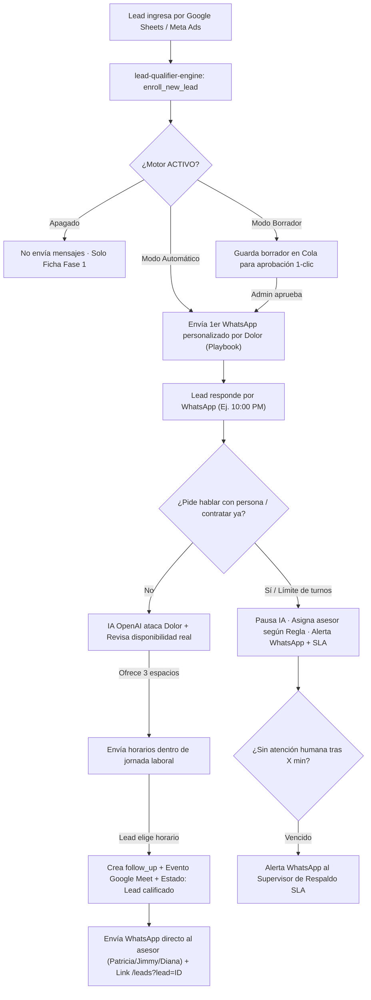

# SOP Operativo — Fases 2 y 3: Calificador IA por WhatsApp (24/7), Auto-Agendamiento Google Meet, Enrutamiento Dinámico y Alertas SLA

> **Propósito:** Atender al instante a los prospectos provenientes de Google Sheets / Meta Ads vía Evolution API atacando su dolor específico, responder 24/7 sin enfriar leads nocturnos (ej. 10:00 PM), agendar Demos con Google Meet dentro del horario laboral real, trasladar a asesor humano cuando el cliente lo solicita y notificar por WhatsApp directo al ejecutivo asignado con enlace a su ficha y escalamiento SLA anti-fuga.

---

## 1. Arquitectura de Seguridad y Aislamiento Multi-Tenant SaaS

El módulo opera de forma totalmente independiente (`lead_qualifier_configs`, `lead_demo_routing_rules`, `lead_qualifier_sessions`) y **NO modifica ni reactiva** el contestador global de Soporte Técnico:

1. **Desactivación Segura de Fábrica:** Toda empresa nueva inicia con el motor maestro **APAGADO (`is_enabled = false`)** y en modo **Borrador (`mode = 'draft'`)**. No envía mensajes reales hasta aprobación explícita del administrador.
2. **Aislamiento de Chats Históricos y Soporte:** `evolution-whatsapp-webhook` únicamente enruta al `lead-qualifier-engine` conversaciones con `wa_scope === 'lead'` marcadas con `ai_qualifier_active === true`, excluyendo grupos, clientes de soporte, notas de voz e importaciones históricas (`catchup`).
3. **Evolution API sin bloqueo de plantilla 24h Meta:** Los saludos iniciales y alertas al equipo utilizan Evolution API (`whatsapp_outbox`), evitando bloqueos por falta de plantillas de Meta Cloud API.
4. **Control Humano Prioritario (`Human Takeover`):** En cuanto un asesor responde manualmente desde el CRM (`send_reply` / `send_media`) o desde su propio teléfono conectado (`fromMe`), el webhook pausa automáticamente la IA en ese chat (`human_takeover`).

---

## 2. Flujo Completo End-to-End

---

## 3. Configuración desde el Frontend (`/leads/calificador-ia`)

Acceso exclusivo para `company_admin` y `super_admin` desde **Sidebar → Prospectos → Calificador IA** o desde el botón **Calificador IA** en la barra de Prospectos.

### Pestaña 1: Control Maestro & Horario 24/7
- **Interruptor Maestro:** `Motor IA: APAGADO (Seguro)` vs `ACTIVO`.
- **Modo de Operación:**
  - **Borrador (Manual):** Redacta el primer mensaje personalizado y espera confirmación manual en **Cola Borradores & Simulador** antes de enviar por WhatsApp.
  - **Automático 24/7:** Envía al entrar el lead desde orígenes permitidos (`google_sheets`, `facebook_ads`).
- **Cobertura Nocturna 24/7 (`response_24_7`):** Permite responder de noche o fines de semana (ej. 10:00 PM) para no perder al cliente caliente, restringiendo la oferta de horarios de Demo estrictamente a la jornada laboral configurada (`L-V` y sábado opcional), duración de demo (`30 min`) y margen entre citas (`15 min`).

### Pestaña 2: Prompts y Traspaso Humano
- **Primer Saludo Automático:** Plantilla editable con variables `{nombre}`, `{empresa}`, `{dolor}`, `{propuesta_dolor}`, `{pregunta_dolor}` y vista previa instantánea.
- **System Prompt:** Instrucciones consultivas modificables sin tocar código.
- **Protocolo de Traspaso (`handoff_keywords`):** Frases determinísticas (*"hablar con alguien"*, *"persona real"*, *"llámame"*, *"ya quiero contratar"*) y plantillas diferenciadas para horario laboral vs fuera de horario.

### Pestaña 3: Playbooks por Dolor
- Catálogo editable con activación individual para: *Inventarios y Productos*, *Facturación Electrónica DTE*, *Control Integral del Negocio*, *Contabilidad y Finanzas*, *Ventas y Compras*, y *SIPLE · Lotificadoras*.
- Cada playbook define palabras clave del Excel, módulos fuertes a destacar, propuesta de valor y pregunta calificadora.

### Pestaña 4: Asesores, WhatsApp Directo & SLA
- **Reglas Dinámicas de Enrutamiento (`lead_demo_routing_rules`):** Permiten configurar asignación **Fija** o **Round-Robin** por producto (Global / ERP / SIPLE) eligiendo responsables y copias en WhatsApp (ej. Patricia, Diana, Jimmy o nuevos miembros sin código).
- **Alertas Ejecutivas por WhatsApp (`ticket_id = null`):** Se envían directo al celular registrado en `profiles.phone` del asesor sin crear tickets falsos en la bandeja de chat de WhatsApp, incluyendo nombre, empresa, teléfono, dolor, urgencia, enlace de Google Meet y deep-link directo `https://ariascrm.com/leads?lead=<ID>`. Echo detection ignora el rebote `fromMe` para mantener limpias las bandejas.
- **Botón `Enviar WhatsApp de Prueba al Asesor`:** Verifica en 1 clic la entrega real al celular de cualquier asesor seleccionado.
- **Escalamiento SLA Anti-Fuga:** Si un traspaso humano (`handed_off`) no es atendido dentro del límite (`sla_escalation_minutes`), el sistema escala por WhatsApp y campana CRM al supervisor de respaldo (`sla_backup_user_id`).

### Pestaña 5: Cola Borradores & Simulador Seguro (Dry-Run)
- **Cola de Borradores y Sesiones:** Permite editar y aprobar con 1 clic borradores pendientes, ver enlaces Meet agendados y pausar/reactivar la IA por lead.
- **Simulador Seguro (0 envíos reales):** Simula 1er saludo, respuestas a las 10:00 PM vs 10:00 AM, oferta de horarios reales, reserva de Demo y vista previa de la alerta al asesor sin enviar WhatsApps reales ni alterar datos.

---

## 4. Control Directo por Conversación en Chat WhatsApp (`/support/chat`)

1. En la lista izquierda, los leads atendidos por el calificador muestran insignias claras: `IA` (activo), `Asesor` (solicitó humano), `Demo` (reunión agendada).
2. Sobre la conversación abierta aparece la barra de control del Calificador IA con el botón **Pausar IA aquí** / **Reactivar IA aquí**.
3. Si un asesor humano escribe cualquier mensaje en el chat (desde CRM o WhatsApp del celular), el bot cede el control automáticamente.

---

## 5. Protocolo Recomendado de Activación Gradual

1. Verificar en **Equipo** que Patricia, Jimmy, Diana y supervisores tengan su número WhatsApp correcto en `profiles.phone`.
2. Configurar reglas de enrutamiento y usar **Enviar WhatsApp de Prueba al Asesor**.
3. Probar escenarios en **Simulador Seguro** (10:00 PM y traspaso humano).
4. Activar el motor en modo **Borrador (Manual)** durante 48 horas aprobando mensajes en la Cola.
5. Una vez validado el tono comercial, cambiar a modo **Automático 24/7**.
